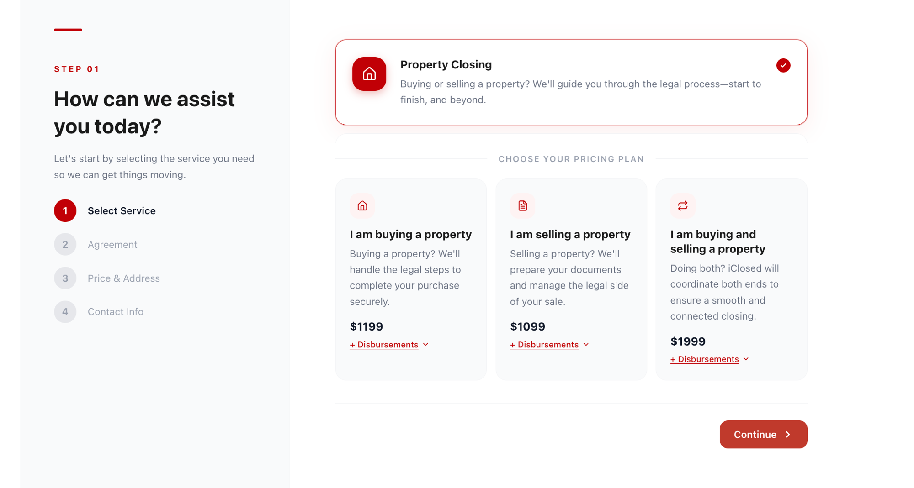

# iClosed requirements (example)

Each `###` heading is one requirement. Optional lines inside it:
`Start: /path` (page to begin on, default `/`) and `Auth: yes` (begin signed in as the test user).

## Public site

### PUB-1 Home page
Start: /
- The home page shows the iClosed logo and a clear call to action to get started or get a quote.
- The navigation includes a link to the closing cost calculator.

### PUB-2 Closing cost calculator
Start: /closing-cost-calculator
- A visitor can enter a purchase price of $800,000 for a property in Toronto.
- The calculator shows a land transfer tax amount, including the Toronto municipal portion.
- A total estimated closing cost is displayed.

### PUB-3 Login validation
Start: /login
- Submitting the form with a wrong password shows an error message and does not sign in.
- There is a "Forgot password" link that leads to a password reset page.

### PUB-4 Dark mode toggle
Start: /
- A visitor can switch the site between light and dark mode from the header.

## Client portal

### PORTAL-1 Dashboard task list
Start: /dashboard
Auth: yes
- A signed-in client sees their deal's closing date and a list of tasks with their status.

## Intake

### INTAKE-1 Property closing step matches the design
Start: /intake
- The first intake step looks like the mockup below: the same question and the same choices.

